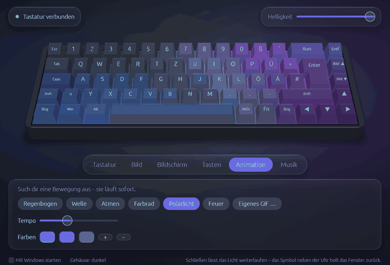
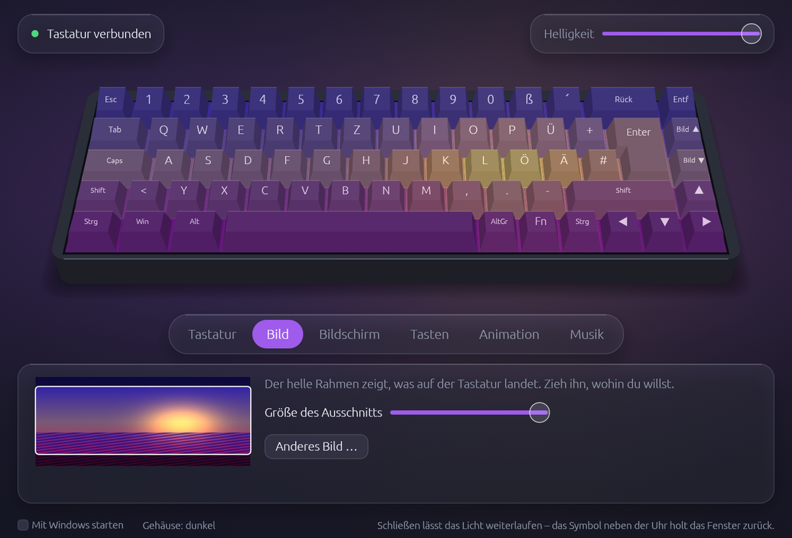
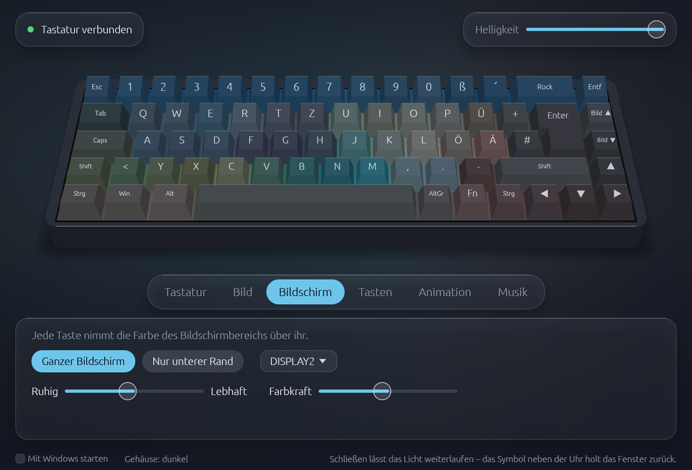
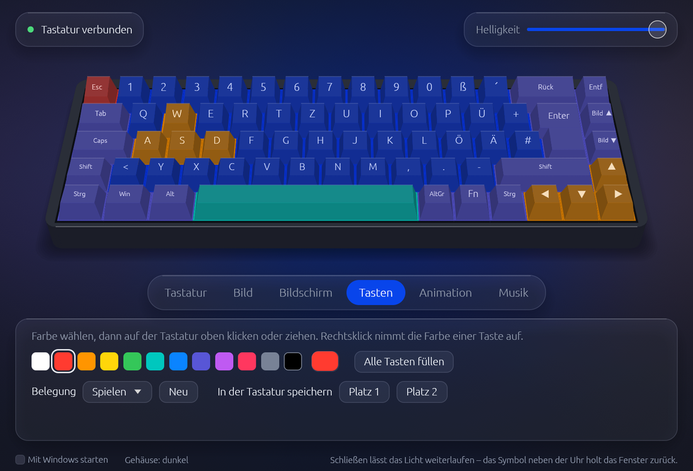
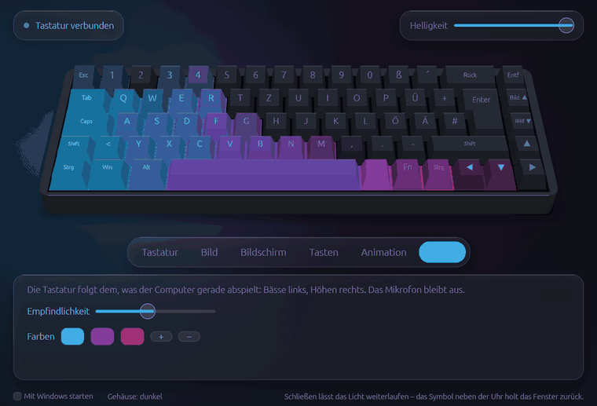
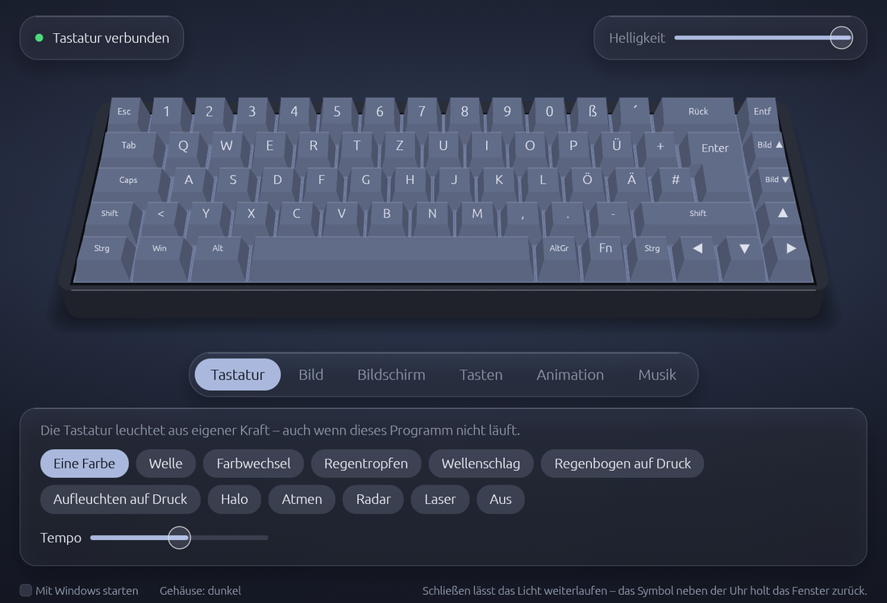

# duckylight

**Light for the Ducky One 3 SF RGB — a picture, your screen's colours, your own key colours,
animations, or the music that is playing. Live, on the keyboard.**



duckylight is two things that belong together:

- a **firmware** for the Ducky One 3 SF RGB (ISO), a QMK port that can be lit from the computer
  and still does everything by itself when the computer is off, and
- a **desktop program** for Windows and Linux that does the lighting. Its window is the keyboard
  itself: a model built to the board's real measurements that shows, key by key, what is lit.

> This is an independent project. It is not made, endorsed or supported by Ducky.

## What it does

Six modes. Choosing one starts it — there is nothing to apply.

| | |
|---|---|
|  | **Picture.** Drop an image on the window and drag the bright frame to the part you want. |
|  | **Screen.** Every key takes the colour of the part of the screen above it, live. Whole screen or just its lower edge; calm or lively. |
|  | **Keys.** Pick a colour and paint on the keyboard. Keep as many layouts as you like; *save to keyboard* burns one into the board, and it then lights up without the computer. |
|  | **Music.** Follows what the computer is playing: bass on the left, treble on the right. Only playback is analysed — never the microphone. |
|  | **Keyboard.** The board's own twelve effects, which run without this program. |

Plus **animations** (the one at the top of this page is one of six) and your own **GIFs**.

Closing the window does not stop the light: duckylight keeps running in the tray, and the icon
there brings the window back or quits. (Not on Linux under Wayland, where a window cannot be
hidden: there the light runs while the window is open, or from the command line.)

The interface is in German.

## Before you start: the firmware

duckylight talks to its own firmware, not to the one the keyboard ships with. With the stock
firmware, the program recognises the keyboard and tells you what is missing; it does not flash
anything itself.

**Flashing firmware is at your own risk.** What keeps it recoverable on this board:

- The bootloader lives in a separate part of the flash that this project never writes, and the
  chip is configured to always start it first. **Hold `D` + `L` while plugging in** and the
  keyboard is in its bootloader, whatever firmware is on it.
- From there the ISP tool below writes any image, including Ducky's own, which is how this
  project went back to stock firmware and forth again while it was built.

How to build and flash is in [`docs/bauen-und-flashen.md`](docs/bauen-und-flashen.md) (German).
In short: the firmware is the keyboard directory [`keyboards/ducky/one3/sf_rgb`](keyboards/ducky/one3/sf_rgb)
inside a QMK tree with the NUC126 HAL, and it is written with
[ducky-one3-isp](https://github.com/mdmower/ducky-one3-isp). A ready-built image is attached to
each [release](https://github.com/Liohtml/duckylight/releases).

This port is for the **One 3 SF RGB with ISO layout** (USB ID `3233:5311`, 68 keys). Other One 3
models have other matrices and LED maps and need their own port.

## Install

**Windows** — download `duckylight-…-windows.exe` from the
[latest release](https://github.com/Liohtml/duckylight/releases/latest) and double-click it.
Click **Installieren** in the window: it puts itself into the Start menu and starts with Windows
from then on. No administrator rights. Remove it like any other app under *Installed apps*.
The file is not code-signed, so Windows SmartScreen may ask before the first start.

**Linux** — download `duckylight-…-linux-x86_64.tar.gz`, unpack it and run `./install.sh`. It
installs for your user and sets up one udev rule (the only step that asks for `sudo`), so the
keyboard's lighting interface can be opened without root.

- Screen colours work on Hyprland, Sway and X11. On GNOME and KDE under Wayland the desktop only
  hands out the screen through a permission dialog; that path is not built, and the program says so.
- Music mode needs `parec` (package `libpulse` or `pulseaudio-utils`).
- The archive is built on Arch Linux and needs a correspondingly recent glibc. On older
  distributions, build from source.

## From scripts

```
duckylight screen                      screen colours until Ctrl-C
duckylight image picture.png           show a picture
duckylight anim fire --speed 1.5       rainbow, wave, breathe, wheel, aurora, fire
duckylight gif dance.gif
duckylight music
duckylight profile "Arbeit" --slot 1   burn a saved layout into the keyboard
duckylight device                      hand the lighting back to the keyboard
duckylight info | state | probe        what the firmware and the computer report
```

Exactly one program holds the keyboard. If duckylight is already running — in the tray, too — a
second call ends with exit code 3.

## Left out on purpose

- **Effects that react to key presses, done on the computer.** The program would have to read
  every keystroke on the system. The keyboard can do reactive effects by itself, with nobody
  listening: they are among its own twelve.
- **Music from the microphone.** Only what the computer plays is analysed. A microphone would
  record the room.

## How it holds together

- The keyboard never depends on the program. Two seconds without a frame from the computer and it
  returns to the lighting it has saved — a crashed program does not leave a dark keyboard.
- The keyboard's flash is written only when you ask for it (*save to keyboard*), never per frame.
- The wire format is small and documented: [`docs/protokoll.md`](docs/protokoll.md) (German).
  Anything that can send 32-byte HID reports can light the board.
- How the board's wiring was worked out: [`docs/hardware-sf.md`](docs/hardware-sf.md) (German).

## Status

Version 0.1.0 — new, and tested on few machines.

| | |
|---|---|
| Firmware | accepted on the real board: typing under a continuous animation, about 89 frames a second over raw HID, pulling the cable mid-frame, an empty data flash, and the way back to stock firmware |
| Windows 11 | built and run with the keyboard: all modes, install and uninstall without administrator rights |
| Linux (Hyprland) | built and run; screen capture and audio capture measured there. **Not yet run with the keyboard attached**, so the udev rule is untested |
| Suspend and resume | not yet tested |
| `Fn` + `Esc` | restarts the keyboard but does not reliably reach the bootloader; `D` + `L` while plugging in always does |

## Build

```
cd host
cargo test --no-default-features                             # the core, anywhere
LINUX_BUILD_HOST=user@host packaging/build-release.sh        # both release files into dist/
```

The Windows file is cross-compiled on Linux (`x86_64-pc-windows-gnu`, mingw-w64). The Linux build
needs the development packages of GTK 3, ALSA, PipeWire and D-Bus. The firmware's host tests run
with `make -C tests/fmc`, `make -C tests/lighting` and `make -C tests/host_rgb`.

## Thanks

- [QMK](https://qmk.fm) and ChibiOS-Contrib's NUC126 HAL.
- The QMK port for the full-size Ducky One 3 RGB by doombadroid, which showed how this family of
  boards is put together.
- [ducky-one3-isp](https://github.com/mdmower/ducky-one3-isp), which makes flashing these boards
  possible without Ducky's updater.

## Licence

GPL-2.0-or-later, see [`LICENSE`](LICENSE). Ducky's own firmware is not part of this repository.
